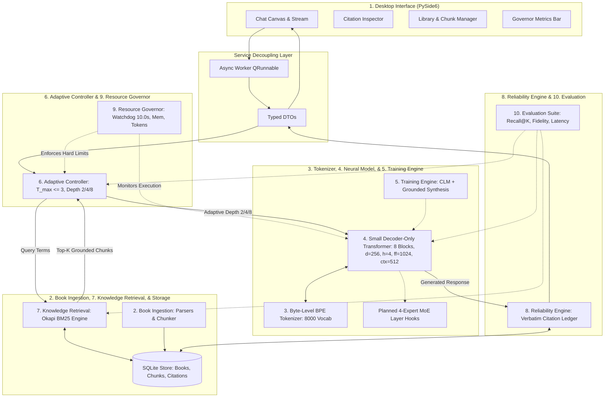

# AHIA-R2 Book Intelligence: System Architecture Specification

## 1. Architectural Mission & Overview

**AHIA-R2 Book Intelligence** is an open-source, fully offline desktop AI research demonstration. The system is powered by a custom **decoder-only Transformer** initialized with random weights and trained entirely from scratch (zero pretrained weights, zero pretrained embeddings, zero remote AI APIs). It is grounded on a local knowledge library of six foundational personal-finance books via **Okapi BM25** retrieval, an adaptive bounded controller, persistent **SQLite** cataloging, and a **PySide6** desktop interface.



---

## 2. The 10 Decoupled Subsystems

The system architecture cleanly partitions all responsibilities across ten standalone subsystems:

### 2.1 Subsystem 1: Desktop Interface (`ui/`)
- **Technology**: PySide6 (Qt for Python).
- **Responsibilities**:
  - Chat canvas with responsive token streaming.
  - Interactive citation side drawer displaying book, chapter, and verbatim excerpt.
  - Knowledge library manager (visualizing book status, word count, chunk count, and index rebuild).
  - Real-time diagnostics bar displaying governor metrics (CPU time, tokens/sec, iteration count, memory).
- **Boundary**: Strict decoupling. The UI layer **never** imports PyTorch or tensor structures. Interacts solely with `service/dto.py`.

### 2.2 Subsystem 2: Book Ingestion (`core/ingestion/`)
- **Responsibilities**:
  - Ingestion of `.txt`, `.pdf`, and `.epub` documents.
  - Text normalization: Unicode NFKC, whitespace compaction, hyphenation reconstruction.
  - Metadata-preserving sliding-window chunking (250 words per chunk, 50-word overlap, breaking on sentence/paragraph boundaries).
  - Storage of parsed books, chapters, and chunks into SQLite.

### 2.3 Subsystem 3: Tokenizer & Dataset Preparation (`core/tokenizer/`, `core/dataset/`)
- **Responsibilities**:
  - From-scratch Byte-Level BPE tokenizer training on the authorized domain corpus.
  - Base byte alphabet of 256 tokens ensuring zero `<unk>` crashes on valid UTF-8.
  - Target vocabulary size: 8,000 tokens.
  - Special control tokens: `<pad>`, `<bos>`, `<eos>`, `<unk>`, `<query>`, `<context>`, `<response>`, `<cite>`, `<nocontext>`.
  - Construction of tokenized pretraining datasets (causal LM) and context-conditioned grounded synthesis datasets.

### 2.4 Subsystem 4: Neural Model (`core/model/`)
- **Configuration (Pure PyTorch, Random Initialization)**:
  - **Transformer Blocks**: 8 blocks
  - **Hidden Dimension ($d_{\text{model}}$)**: 256
  - **Attention Heads**: 4 heads ($d_k = 64$)
  - **Feed-Forward Dimension ($d_{\text{ff}}$)**: 1024
  - **Vocabulary Size**: 8,000 tokens
  - **Context Window ($L_{\text{ctx}}$)**: 512 tokens
  - **Parameter Count**: ~14.8M parameters
  - **Positional Encoding**: Rotary Position Embeddings (RoPE)
  - **Normalization**: Pre-Layer RMSNorm
  - **Activation**: SwiGLU / GELU
  - **Adaptive Execution Depths**: Variable exit depths at 2, 4, and 8 blocks for dynamic compute scaling
  - **Mixture of Experts (MoE) Roadmap**: Modular routing hooks for 4 planned feed-forward experts (scheduled after dense baseline validation)
  - **Autoregressive Decoding**: Stateful Key-Value (KV) cache for fast $O(1)$ token step inference on CPU.

### 2.5 Subsystem 5: Training Engine (`core/training/`)
- **Responsibilities**:
  - Stage 1: Domain-specific Causal Language Modeling (CLM) using cross-entropy loss from random weight initialization.
  - Stage 2: Grounded synthesis fine-tuning conditioned on retrieved chunks, enforcing citation tags and negative refusal behavior.
  - Optimizer: AdamW with cosine decay, linear warmup, and gradient norm clipping.
  - Checkpoint serialization and optimizer state management.

### 2.6 Subsystem 6: Adaptive Controller (`core/controller/`)
- **Responsibilities**:
  - Manages the iterative retrieval-and-reasoning loop with a deterministic maximum of $T_{\max} \le 3$ iterations.
  - Query intent detection and lexical decomposition.
  - Dynamic execution depth selection:
    - Depth 2 blocks: Low-complexity classification / refusal detection.
    - Depth 4 blocks: Direct factual query extraction.
    - Depth 8 blocks: Multi-chunk synthesis and comparative queries.
  - Query reformulation trigger when BM25 score confidence is below threshold $\theta_{\min}$.

### 2.7 Subsystem 7: Knowledge Retrieval (`core/retrieval/`)
- **Responsibilities**:
  - Okapi BM25 / BM25+ inverted index built from scratch.
  - Document frequency and term frequency caching.
  - Top-$K$ candidate passage selection ($K \in [3, 5]$).
  - Relevance score normalization and candidate filtering.

### 2.8 Subsystem 8: Reliability Engine (`core/reliability/`)
- **Responsibilities**:
  - Citation ledger verification: every generated claim or quote is cross-referenced against the retrieved chunks in SQLite.
  - Anti-fabrication guard: suppresses ungrounded assertions or replaces them with verbatim chunk extractions.
  - Rejection handler: triggers explicit refusal when no verified grounding exists.

### 2.9 Subsystem 9: Resource Governor (`core/governor/`)
- **Responsibilities**:
  - Independent watchdog thread executing outside the PyTorch forward pass.
  - Hard wall-clock timeout ceiling: 10.0 seconds maximum per user query.
  - Maximum output token limit: 256 tokens.
  - Process memory ceiling monitoring and emergency abort handlers.

### 2.10 Subsystem 10: Evaluation Suite (`core/evaluation/`)
- **Responsibilities**:
  - Automated benchmark pipelines for retrieval recall@K, mean reciprocal rank (MRR), and precision.
  - Citation fidelity and hallucination rate measurement on synthetic evaluation benchmarks.
  - Latency profiling (tokens/second, TTFT - time to first token) across execution depths 2, 4, and 8.
  - Deterministic loop limit and timeout trigger tests.

---

## 3. SQLite Database Schema (`database/schema.py`)

A local SQLite database (`data/ahia_knowledge.db`) provides persistent, transactional storage:

```sql
CREATE TABLE IF NOT EXISTS books (
    book_id TEXT PRIMARY KEY,
    title TEXT NOT NULL,
    author TEXT NOT NULL,
    source_path TEXT,
    format TEXT NOT NULL,
    total_words INTEGER DEFAULT 0,
    created_at TIMESTAMP DEFAULT CURRENT_TIMESTAMP
);

CREATE TABLE IF NOT EXISTS chapters (
    chapter_id TEXT PRIMARY KEY,
    book_id TEXT NOT NULL,
    chapter_number INTEGER,
    title TEXT NOT NULL,
    start_char INTEGER NOT NULL,
    end_char INTEGER NOT NULL,
    FOREIGN KEY(book_id) REFERENCES books(book_id) ON DELETE CASCADE
);

CREATE TABLE IF NOT EXISTS chunks (
    chunk_id TEXT PRIMARY KEY,
    book_id TEXT NOT NULL,
    chapter_id TEXT,
    chunk_index INTEGER NOT NULL,
    char_start INTEGER NOT NULL,
    char_end INTEGER NOT NULL,
    word_count INTEGER NOT NULL,
    token_count INTEGER NOT NULL,
    content TEXT NOT NULL,
    FOREIGN KEY(book_id) REFERENCES books(book_id) ON DELETE CASCADE,
    FOREIGN KEY(chapter_id) REFERENCES chapters(chapter_id) ON DELETE SET NULL
);

CREATE TABLE IF NOT EXISTS bm25_terms (
    term TEXT NOT NULL,
    chunk_id TEXT NOT NULL,
    term_frequency INTEGER NOT NULL,
    PRIMARY KEY(term, chunk_id),
    FOREIGN KEY(chunk_id) REFERENCES chunks(chunk_id) ON DELETE CASCADE
);

CREATE TABLE IF NOT EXISTS execution_logs (
    log_id INTEGER PRIMARY KEY AUTOINCREMENT,
    query_text TEXT NOT NULL,
    execution_depth INTEGER NOT NULL,
    iterations_used INTEGER NOT NULL,
    latency_ms REAL NOT NULL,
    tokens_generated INTEGER NOT NULL,
    governor_interrupted BOOLEAN NOT NULL DEFAULT 0,
    timestamp TIMESTAMP DEFAULT CURRENT_TIMESTAMP
);
```

---

## 4. Module Interface Contracts (`core/interfaces/`)

All cross-module interactions are strictly bound by Python `Protocol` definitions:

```python
# Document Ingestion Protocol
class ChunkerProtocol(Protocol):
    def chunk_document(self, text: str, book_id: str, chapter_id: Optional[str] = None) -> List[Chunk]: ...

# Tokenizer Protocol
class TokenizerProtocol(Protocol):
    def encode(self, text: str, add_special_tokens: bool = True) -> List[int]: ...
    def decode(self, token_ids: List[int], skip_special_tokens: bool = True) -> str: ...
    @property
    def vocab_size(self) -> int: ...

# Retrieval Protocol
class RetrievalIndexProtocol(Protocol):
    def search(self, query: str, top_k: int = 5) -> List[ScoredChunk]: ...
    def index_chunks(self, chunks: List[Chunk]) -> int: ...

# Neural Model Protocol
class ModelProtocol(Protocol):
    def forward(self, input_ids: Any, depth: int = 8, kv_cache: Optional[Any] = None) -> Any: ...
    def generate(self, prompt_tokens: List[int], max_new_tokens: int, depth: int = 8) -> List[int]: ...

# Adaptive Controller Protocol
class AdaptiveControllerProtocol(Protocol):
    def execute(self, query: str, max_iterations: int = 3) -> ControllerResult: ...

# Resource Governor Protocol
class ResourceGovernorProtocol(Protocol):
    def start_watchdog(self, timeout_seconds: float = 10.0) -> None: ...
    def check_limits(self, current_tokens: int) -> bool: ...
    def stop_watchdog(self) -> ExecutionTelemetry: ...

# Reliability Protocol
class CitationVerifierProtocol(Protocol):
    def verify_grounding(self, response_text: str, retrieved_chunks: List[Chunk]) -> GroundingReport: ...
```

---

## 5. Adaptive Depth & Bounded Reasoning Loop

```
User Query ──► [Query Analysis & Intent Classifier]
                      │
                      ▼
               [Depth Selection]
           ┌──────────┼──────────┐
      Depth 2      Depth 4    Depth 8
   (Fast/Refusal) (Factual) (Synthesis)
           └──────────┬──────────┘
                      ▼
             [BM25 Retrieval Search]
                      │
           Confidence >= Threshold?
           ├──► YES: Autoregressive Decode (Selected Depth) ──► Grounding Validator ──► Verified Response
           └──► NO:  Iteration < T_max (3)?
                     ├──► YES: Query Reformulation & Expansion ──► Loop to Retrieval
                     └──► NO:  Graceful Fallback ("Concept not found in library")
```

The outer Resource Governor supervisor runs in an isolated thread and immediately interrupts execution if the clock reaches 10.0 seconds or token generation exceeds 256 tokens.
