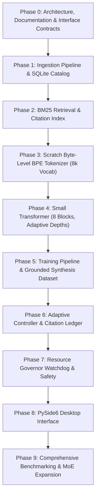

# AHIA-R2 Book Intelligence: Phased Development Roadmap

This document outlines the sequential, test-driven development roadmap for AHIA-R2 Book Intelligence. Each phase is gated by explicit verification tests and exit criteria.

---

## Roadmap Overview & Phase Gates

---

## Phase Breakdown

### Phase 0: Architecture, Documentation & Module Interface Contracts
- **Objective**: Establish complete repository structure, operational governance, dependencies, SQLite schemas, module interfaces, and technical documentation.
- **Deliverables**:
  - `README.md`, `AGENTS.md`, `LICENSE`, `pyproject.toml`, `requirements.txt`.
  - Documentation: `architecture.md`, `training_plan.md`, `data_policy.md`, `development_roadmap.md`.
  - Interfaces for all 10 subsystems in `core/interfaces/`.
  - SQLite database DDL schema in `database/schema.py`.
- **Exit Criteria**: `tests/test_repository_consistency.py` passes 100% of checks.

### Phase 1: Book Ingestion Pipeline & SQLite Catalog (`core/ingestion/`)
- **Objective**: Implement multi-format document parsers (`.txt`, `.pdf`, `.epub`) and metadata-preserving sliding-window chunking.
- **Deliverables**:
  - `DocumentParser`, `TextNormalizer`, `SlidingWindowChunker`.
  - SQLite repository inserting books, chapters, and chunks.
- **Exit Criteria**: Unit tests verifying chunk length constraints, sentence boundary preservation, and SQLite roundtrip.

### Phase 2: BM25 Knowledge Retrieval Subsystem (`core/retrieval/`)
- **Objective**: Implement pure-Python Okapi BM25 and BM25+ indexing.
- **Deliverables**:
  - Inverted index builder, document length statistics, TF-IDF scoring.
  - Candidate ranking, thresholding, and top-$K$ passage retrieval.
- **Exit Criteria**: Retrieval recall tests on synthetic corpus, scoring correctness verification.

### Phase 3: Scratch Byte-Level BPE Tokenizer (`core/tokenizer/`)
- **Objective**: Build and train a Byte-Level BPE tokenizer from scratch without external pretrained weights or models.
- **Deliverables**:
  - Byte-alphabet base (256 tokens), pair-frequency counter, merge-table trainer.
  - Vocabulary builder reaching 8,000 target tokens.
  - Special tokens: `<pad>`, `<bos>`, `<eos>`, `<unk>`, `<query>`, `<context>`, `<response>`, `<cite>`, `<nocontext>`.
- **Exit Criteria**: 100% roundtrip encode-decode fidelity on UTF-8 test sequences with zero `<unk>` fallback crashes.

### Phase 4: Small Decoder-Only Transformer (`core/model/`)
- **Objective**: Pure PyTorch implementation of the compact neural model from random initialization.
- **Deliverables**:
  - 8 Transformer blocks, hidden dim 256, 4 attention heads, ff dim 1024, context 512.
  - RoPE positional embeddings, RMSNorm, SwiGLU / GELU activations.
  - Adaptive execution depth exits at block 2, block 4, and block 8.
  - Stateful Key-Value (KV) cache for fast autoregressive CPU decoding.
  - Four planned MoE feed-forward routing hooks (stubbed for future activation).
- **Exit Criteria**: Forward pass tensor shape tests, KV-cache output equivalence tests.

### Phase 5: Training Engine & Grounded Synthesis Tuning (`core/training/`)
- **Objective**: Pure PyTorch training loops for causal LM pretraining and context-conditioned grounded synthesis.
- **Deliverables**:
  - Multi-depth loss aggregator ($\mathcal{L}_{\text{total}} = 0.2\mathcal{L}_2 + 0.3\mathcal{L}_4 + 0.5\mathcal{L}_8$).
  - Synthetic dataset generator for context extraction and refusal behavior.
  - AdamW optimizer, cosine learning rate scheduler, checkpoint serializer.
- **Exit Criteria**: Loss descent on synthetic training batches, checkpoint save/restore tests.

### Phase 6: Adaptive Controller & Reliability Engine (`core/controller/`, `core/reliability/`)
- **Objective**: Bounded reasoning loop ($T_{\max} \le 3$) and strict citation ledger verification.
- **Deliverables**:
  - Adaptive depth selector (2, 4, 8 blocks) and query reformulation logic.
  - Citation verifier checking generated citations against SQLite chunk records.
  - Explicit refusal trigger for missing context.
- **Exit Criteria**: Deterministic loop cutoff tests ($T_{\max} = 3$), citation validation tests.

### Phase 7: Resource Governor Watchdog (`core/governor/`)
- **Objective**: Independent supervisor thread enforcing hard wall-clock and memory limits.
- **Deliverables**:
  - Watchdog timer thread (10.0s hard ceiling).
  - Memory ceiling checker and 256-token output limit.
- **Exit Criteria**: Unit tests simulating delayed execution and verifying forced abort.

### Phase 8: PySide6 Desktop User Interface (`ui/`, `service/`)
- **Objective**: Modern, native desktop interface fully decoupled from PyTorch.
- **Deliverables**:
  - Async `QRunnable` worker thread pool and typed DTOs.
  - Chat canvas with streaming text, citation inspector side drawer, library manager, and diagnostics bar.
- **Exit Criteria**: UI component unit tests, verify 0 PyTorch imports in `ui/`.

### Phase 9: End-to-End Evaluation & Benchmarking (`core/evaluation/`)
- **Objective**: Comprehensive system benchmarking, offline audit, and MoE expansion validation.
- **Deliverables**:
  - Full automated evaluation suite: Recall@K, citation fidelity, latency profiling.
  - Offline audit verifying zero network connectivity.
  - Complete user guide and research demonstration report.
- **Exit Criteria**: 100% pytest pass across all suites, verification of 15 non-negotiable rules.
